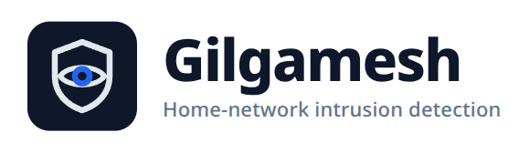

<p align="center">
  
</p>
<p align="center">
  <em>He who sees everything.</em>
</p>

# Gilgamesh

**A watchful guardian for your home network.** Gilgamesh is an open-source
intrusion detection system (a "NIDS") that runs on a Raspberry Pi 4, watches the
traffic on your network like a security camera watches a door, and tells you —
in a web page, or a message in **Discord, Telegram, or email** — when something
looks like an attack.

> **It only detects and alerts.** Gilgamesh never blocks anyone, never slows
> your internet down, and is not a firewall or a router. If it has an opinion,
> it shares it; you decide what to do.

It is built for people who are **not** security experts: everything is done in
the browser, there is nothing to type into a terminal after the 15-minute
install, and every alert explains itself in plain sentences.

---

## What it notices

| Attack | What that actually means |
|---|---|
| **ARP spoofing** | Someone's device is pretending to be *your router* so they can quietly intercept your traffic |
| **DNS spoofing** | Something is feeding your devices fake answers — you type `mybank.example` and land somewhere else |
| **Rogue DHCP server** | Someone is handing out network configurations (or trying to exhaust them) so they become the "office manager" of your network |
| **Port scans & SYN floods** | An internet address is walking up and down your connections, knocking on every door to find one left open |
| **New devices** | A phone, a laptop, or a mysterious gadget you have never seen joins your network |
| **Signature alerts** | [Suricata](https://suricata.io) with the free *Emerging Threats* rule set chimes in on known attack patterns |

Each has a sensitivity you can tune (or switch off) in one click — bundled
false-positive guards mean normal browsing, backups, game servers and
round-robin websites stay silently in the background.

<p>
  
  
</p>

## How it works

The Pi sits (optionally) *inline* between the router and the rest of your home,
so every packet passes through. Two inspection engines read that traffic:

1. **Custom detectors** — a small state machine per attack family, built on
   [Scapy](https://scapy.net), for the local-network tricks signature engines
   handle badly, featuring lenient warm-up learning periods and suspicious
   behaviour thresholds tuned for real households rather than data centres; and
2. **Suricata** — the well-known open-source IDS, wired to Gilgamesh's alert
   pipeline for known signature matches.

Everything they raise is deduplicated, rate-limited and aggregated first:
one outage storm never becomes ten thousand phone calls, so the alerts stay
trustworthy.

The full design (architecture, threat model, resource budget, milestone log with
test evidence) lives in [`docs/PLAN.md`](docs/PLAN.md) for the curious.

## The guides

| Guide | Start here if… |
|---|---|
| **[docs/INSTALL.md](docs/INSTALL.md)** | you want it running — from an SD card to a live dashboard, step by step |
| **[docs/USAGE.md](docs/USAGE.md)** | you have an alert and no idea what it means, or just want the full page tour |
| **[docs/DEMO.md](docs/DEMO.md)** | you want to show it to someone without touching your real network |

## For developers / contributors

The whole detection stack runs and tests **without any hardware**: detectors run
on synthetic packets and recorded captures, the browser UI has an end-to-end
suite, and the internal engineering records live under `docs/`.

```sh
uv sync                                    # create the virtualenv (uv only)
uv run pytest                              # unit + UI tests (hermetic, no network)
uv run pytest tests/e2e -m e2e --browser-channel chrome   # real browser, real server
uv run ruff check . && uv run ruff format --check . && uv run pyright
```

To drive the sensor without hardware, replay a capture instead of sniffing:
`GILGAMESH_PCAP=/path/to/capture.pcap GILGAMESH_DATA_DIR=/tmp/gg-dev uv run gilgamesh-sensor`.

The project is built as a college project and under heavy-ish development; see
[`docs/PROGRESS.md`](docs/PROGRESS.md) (milestones + evidence) and
[`docs/BLOCKERS.md`](docs/BLOCKERS.md) (what still needs real hardware).

## Uninstalling

See the [**Uninstalling**](docs/INSTALL.md#uninstalling) section of the install
guide — three services, two directories, nothing else is touched.

## Licence

**GPL-2.0-or-later** — see [LICENSE](LICENSE). Every runtime dependency is open
source, with the full SPDX table in
[`docs/research/12-licenses.md`](docs/research/12-licenses.md). The logo and
screenshots in `docs/images/` are original works made for this project and share
its licence.
