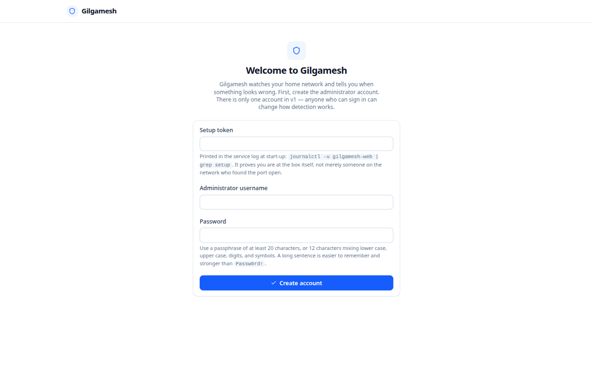
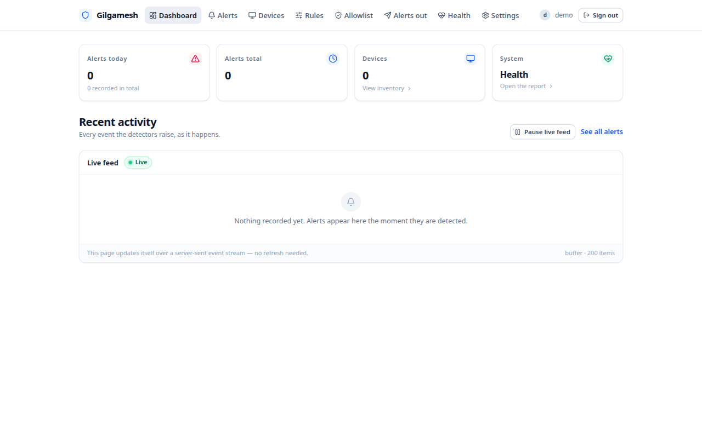

# Install Gilgamesh, step by step

This guide takes you from an empty SD card to a working Gilgamesh — about
**45 minutes**, an hour if you also install **Suricata** (Gilgamesh's second
detection engine). No prior Linux experience is assumed; every command below is
copy-paste-ready, and the text explains each step before you type it.

By the end you will have:

- a Raspberry Pi that watches traffic on your home network 24 hours a day,
- alerts for common attacks going to your phone or desktop browser, plus two
  background services and a 10-second health check you can run at any time.

Two ways to connect the Pi are supported:

- **Mode A — Simple tap.** The Pi sits on the side of your network with one
  Ethernet cable, like a normal computer. It sees your devices and most
  "traffic inside your own network". This is the one-cable option: zero
  rewiring.
- **Mode B — Inline bridge (recommended for daily protection).** The Pi sits
  *between your router and everything else*, with two network interfaces, so it
  sees *all* traffic in and out of your house. This is the recommended mode for
  real protection, but it means plugging the Pi into the middle of your
  internet line — and it is honest enough to say that losing the Pi's power
  will briefly disconnect your internet.

Both modes are fully supported by Gilgamesh; Mode B is what the research notes
(`docs/research/01-network-placement.md`, from the Pi 4 guide) is written
around. You can start in Mode A today and upgrade to Mode B later — nothing is
wasted when you switch.

---

## 1 · What you'll need

| You already own | Why | Notes |
|---|---|---|
| **Raspberry Pi 4 Model B (4 GB)** | the whole thing runs on it | other Pi models are untested; 8 GB is a bonus |
| **MicroSD card, 16 GB+** | the Pi runs off it | faster "A1/A2" cards make history pages snappier |
| **Power supply (official USB-C)** | you don't want brownouts | not a phone charger |
| **Ethernet cable (one for Mode A)** | the connection to your network | |
| **USB 3 Gigabit Ethernet adapter (Mode B)** | becomes the *second* network interface | common AX88179 / RTL8153-based adapters, plugged into the blue USB port |
| **Ethernet cable (a second one, Mode B)** | router→Pi and Pi→network | |
| **A second computer + browser** | to flash the SD card and then use the dashboard | macOS, Windows, Linux, phone all work |

If you're unsure which mode you want: get the single cable working with Mode A
first, then decide later. You will not redo anything by choosing the upgrade.

---

## 2 · Flash Raspberry Pi OS onto the microSD card (≈15 min)

1. On your computer, download the free **[Raspberry Pi Imager](https://www.raspberrypi.com/software/)** and install it.
2. Insert the microSD card into your computer (you may need a card reader).
3. In the Imager choose:
   - *Raspberry Pi Device* → **Raspberry Pi 4**
   - *Operating System* → **Raspberry Pi OS (other)** → **Raspberry Pi OS Lite (64-bit)**
     *(the "Lite" version has no desktop — that is correct; Gilgamesh is used from a browser)*
   - *Storage* → your microSD card
4. Click **Next**, then **Edit Settings**, and set:
   - *Hostname*: `gilgamesh`
   - *Username and password*: pick a username you'll remember and a real
     password (you'll use it every time you connect via SSH)
   - *Configure wireless LAN*: **leave empty** if the Pi will use an Ethernet
     cable (recommended); fill it only if that's your only connection
   - *Enable SSH*: ✔ **Use password authentication**
5. Click **Write** and let the Imager finish, then take the card out and plug
   it into the Pi.

> The full `README` lives on the card; you'll install Gilgamesh *over SSH*
> instead of rigging a monitor to the Pi. That's the normal way and it keeps
> hardware costs down.

---

## 3 · First boot, and finding your Pi's address (≈5 min)

1. Plug the microSD card into the Pi, connect the Ethernet cable from the Pi to
   your router/switch, and power it up. Wait around **90 seconds** for it to
   boot.
2. Find its IP address on your network by either:
   - looking at the **client list on your router's web page** (usually printed
     on the router as `192.168.1.1` or similar) for a device named `gilgamesh`; or
   - opening a terminal (macOS/Linux) or PowerShell (Windows) and trying:

     ```sh
     ping gilgamesh.local
     ```

   If neither works: power-cycle the Pi once more and wait a minute, then check
   the router page again.
3. From your computer, connect over SSH:

   ```sh
   ssh <your-username>@<the-pi's-IP>
   ```

   The first time, it asks you to confirm a fingerprint: type `yes`. Enter the
   password you set in step 2. You are now "inside" the Pi at a command
   prompt — every code block below goes there, one copy-paste at a time.

---

## 4 · The one-time OS prep (≈2 min)

Gilgamesh needs `git` (to fetch the code) and `uv` (to build it). Debian,
which Raspberry Pi OS is built on, only needs one small install for `git`
(`curl` is already there):

```sh
sudo apt-get update
sudo apt-get install -y git
```

Nothing else needs to be installed; Gilgamesh manages its own Python.

### Install `uv` (Gilgamesh's package manager)

`uv` is a fast, standalone Python package manager. The official installer from
the `uv` project sets it up for the superuser, which is who the installer
below runs as:

```sh
sudo sh -c 'curl -LsSf https://astral.sh/uv/install.sh | sh'
```

That's it — no screenfuls of options to babysit.

---

## 5 · Get Gilgamesh's code onto the Pi (≈1 min)

Still inside the Pi over SSH:

```sh
git clone https://github.com/j0yb0y-m/gilgamesh.git
cd gilgamesh
```

If GitHub says the repo is **private** (it is today), you have two options, and
both are normal:

- create a **personal access token** on GitHub (Settings → Developer settings →
  Personal access tokens → * Tokens (classic) with the `repo` scope only) and
  use `https://<that-token>@github.com/j0yb0y-m/gilgamesh.git` as the URL, *or*
- add your **SSH key** to GitHub and clone with
  `git@github.com:j0yb0y-m/gilgamesh.git`.

---

## 6 · Run the installer (≈3 min)

From inside the `gilgamesh` folder:

```sh
sudo ./install.sh
```

This single, idempotent script (safe to run again; it's also the upgrade
command) does the following for you:

- copies itself into `/opt/gilgamesh` and installs Python **3.13** and every
  library into a private virtualenv there — nothing is installed into the
  system Python and no `pip` runs,
- creates the two service accounts (`gilgamesh`, `gilgamesh-sensor`) and the
  shared directory `/var/lib/gilgamesh` where alerts and devices are stored,
- writes the configuration file `/etc/gilgamesh/gilgamesh.env` **on first run
  only** (edits you make later survive upgrades), based on the fully documented
  `deploy/gilgamesh.env.example`,
- installs the systemd units, a daily rule-update timer, and journald size caps
  so the SD card never fills up with logs.

Type `sudo systemctl status gilgamesh-web` when you see the last line — the
word `active (running)` in green is the bar to clear for every check below.

### Installer switches you may actually use

| Command | Use when… |
|---|---|
| `sudo ./install.sh --offline` | you are on a network with no internet (needs `vendor/wheels/' pre-fetched on your dev machine) |
| `sudo ./install.sh --no-start` | you want everything laid down but no service started just yet |
| `sudo ./install.sh --prefix /srv/gilgamesh` | the default install directory `/opt/gilgamesh` doesn't suit you |

> The installer also runs a **self-check** — if a service fails to start, it
> tells you in the last lines which one and why. Fixing an interface name in
> step 7 is the most common fix.

---

## 7 · Choose where the Pi listens for traffic

### Mode A — Simple tap (one cable)

The sensor captures from your Pi's built-in Ethernet card instead of a bridge.
This is the don't-touch-my-router option:

```sh
sudo sed -i 's/^GILGAMESH_INTERFACE=.*/GILGAMESH_INTERFACE=eth0/' /etc/gilgamesh/gilgamesh.env
sudo systemctl restart gilgamesh-sensor
```

You will see the devices page fill up over the next minutes, and it will catch
attacks *waged inside your own network* (the ARP, DHCP and "new device"
detectors). Without Mode B, daytime internet attacks are much quieter *on this
mode only*; it's a great start.

### Mode B — Inline bridge (the recommended mode)

This is the architecture the research and the Pi guide describe: the Pi's two
network interfaces become a switch, so *all* traffic crosses the Pi and nothing
is bypassed.

1. **Plug the hardware in** (Pi powered off, both cables in):

   - `router` → **Pi eth0** (onboard port, usually the innermost jack)
   - **Pi USB 3 adapter** → `switch-WiFi/router-LAN-port` (the rest of your house)

2. **Turn the two interfaces into a bridge**. On current Raspberry Pi OS
   networking is done by NetworkManager, so:

   ```sh
   sudo nmcli con add type bridge con-name br0 ifname br0
   sudo nmcli con modify br0 bridge.stp no
   sudo nmcli con add type ethernet con-name br0-port-eth0 ifname eth0 controller br0
   sudo nmcli con add type ethernet con-name br0-port-eth1 ifname eth1 controller br0
   sudo nmcli con modify br0 ipv4.method auto
   sudo nmcli con up br0
   ```

   Two `nmcli` calls create ports, one makes the bridge visible on the network,
   and the last one stitches them together. STP is turned off because a
   two-port bridge cannot form the loop STP protects against — it just delays
   your traffic.

   `GILGAMESH_INTERFACE` stays `br0` in the environment (the default), so
   nothing more to edit:

   ```sh
   sudo systemctl restart gilgamesh-sensor
   ```

   When everything is live, `ip -br link` shows `br0` up, plus `eth0` and
   `eth1` as its two ports. A **power or boot failure of the Pi now interrupts
   your internet temporarily — that's how an inline bridge works**, and every
   placement document says so honestly; a power bank / UPS makes this rare and
   mild.

---

## 8 · Optional but recommended: two more eyes (Suricata)

Battle-tested, free, and separate from Gilgamesh's own detectors: **Suricata**
watches for *known attack signatures* from the Emerging Threats Open rule set.
Debian 13's main repository ships Suricata 7.0.x — end of life upstream — so
Gilgamesh's research points to Debian's **trixie-backports** suite, which
carries the current 8.0.7:

```sh
echo 'deb http://deb.debian.org/debian trixie-backports main' \
  | sudo tee /etc/apt/sources.list.d/trixie-backports.list
sudo apt-get update
sudo apt-get install -y -t trixie-backports suricata suricata-update
```

Then tell the installer you have it, so it wires up the drop-in config it ships
for Suricata:

```sh
sudo ./install.sh
sudo systemctl restart gilgamesh-sensor
```

That's the whole integration: the sensor listens to Suricata's log file by
default. To pull fresh signatures at any moment, the web app's **Health →
Update rules now** button runs `suricata-update` for you; there's also a daily
timer after install.

> Don't want Suricata? Gilgamesh runs happily without it and the built-in
> detectors don't change. You can add it any time by re-running the two blocks
> above.

---

## 9 · First run: creating your account in the browser

The web service starts one login session that requires a **setup token** — a
one-time code that proves you are at the box and not an intruder who found the
port open. On the Pi:

```sh
sudo journalctl -u gilgamesh-web -n 50 | grep -i setup
```

You'll see a line like:

```text
first-run setup is open: enter setup token 'uIsX…' in the wizard (journalctl -u gilgamesh-web | grep setup)
```

Copy just the quoted text (`uIsX…`).

1. On any device **on the same network**, open
   **`http://<the-pi's-IP>:8080/setup`** (Chrome, Firefox, or Safari work fine).
2. Paste the setup token, choose a **username**, and set a password. The
   password needs to be **at least 20 characters** — or a 12+ character
   password mixing upper case, lower case, digits and symbols. Write it down;
   there is no "forgot my password" button, by design.



3. That's the whole wizard — Gilgamesh now knows you, and the dashboard is live.



---

## 10 · Now what?

Point Gilgamesh's gateway at your actual router so the ARP and DHCP detectors
have a rock-solid baseline, restart the sensors, then go cloud-chasing in the
usage guide:

```sh
sudo sed -i 's|^#GILGAMESH_GATEWAY_IP=.*|GILGAMESH_GATEWAY_IP=192.168.1.1|' /etc/gilgamesh/gilgamesh.env
sudo systemctl restart gilgamesh-sensor gilgamesh-web
```

(Replace `192.168.1.1` with *your* router's address — that's what your
dashboard's IP was in step 3 if you have the router's page open.)

Then go and read the [**usage guide**](USAGE.md). The "First evening checklist"
section will have your notifications running in about five minutes.

---

## Troubleshooting

| Symptom | Likely cause / fix |
|---|---|
| `systemctl status gilgamesh-sensor` says **inactive (dead)** and the log complains the interface is wrong | you may be in Mode A on `br0` (the default interface) or vice versa; set `GILGAMESH_INTERFACE` in `/etc/gilgamesh/gilgamesh.env` to `eth0`, `br0`, or whatever `ip -br link` shows, then `sudo systemctl restart gilgamesh-sensor` |
| The Pi's web page **refuses to connect from another device** | confirm `systemctl status gilgamesh-web` is active and that you are using `http://` and the *Pi's own* IP (not another machine's), then confirm both machines are on the same network — some routers isolate "guest" Wi-Fi |
| A scanner says the port is open but the browser times out | your router has a "AP/client isolation" feature on Wi-Fi — try from a device on the wired LAN |
| You forgot the setup token | `sudo journalctl -u gilgamesh-rules-update` won't help for that; the token was printed by `gilgamesh-web` at its very first start: `sudo journalctl -u gilgamesh-web | grep -i setup` |
| GitHub repo is private | see the two clone options in **step 5** |
| The disk is filling up | alerts delete themselves at 30 days by default (change in Settings), so this shouldn't happen — but the **Health** page's disk number knows; if the card is genuinely small there, a new, larger SD card is the fix (and a backup of `/etc/gilgamesh` speeds re-provisioning) |

<details>
<summary>Verbose log button (advanced)</summary>

Everything is journalled. If a support request ever needs the forensic finger:

```sh
sudo journalctl -u gilgamesh-web -u gilgamesh-sensor -e --no-pager | tail -n 100
```

That's the output to attach — it contains no secrets.

</details>

---

## Updating Gilgamesh

From time to time, update to the newest version:

```sh
cd /home/<your-username>/gilgamesh   # wherever you cloned in step 5
git pull
sudo ./install.sh                   # idempotent — re-running is the upgrade path
```

Your alerts, devices and settings live in `/var/lib/gilgamesh` and are never
touched by the installer.

### Installing on other hardware

Everything except the inline bridge (which wants two wired network interfaces)
works on any Debian-13-based single-board computer. Pi 3 works too; only the
4 GB Pi 4 is *qualified* — the sensors were tuned against the Pi 4's network
card. The regular `x86_64` dev-machine path in the README is the place to
experiment with other boards; see `docs/DEMO.md` for the laptop-only demo
before buying anything.

---

## Uninstalling

Gilgamesh only lives in the places it installed; there is no state on your
router and nothing that phones home. Remove it with:

```sh
sudo systemctl disable --now gilgamesh-web gilgamesh-sensor gilgamesh-rules-update.timer
sudo rm -f /etc/systemd/system/gilgamesh-sensor.service
sudo rm -f /etc/systemd/system/gilgamesh-web.service
sudo rm -f /etc/systemd/system/gilgamesh-rules-update.service
sudo rm -f /etc/systemd/system/gilgamesh-rules-update.timer
sudo rm -rf /etc/gilgamesh /opt/gilgamesh
sudo rm -f /etc/sysusers.d/gilgamesh.conf
sudo rm -rf /var/lib/gilgamesh                                # deletes alerts, devices and settings
sudo rm -f /etc/apt/sources.list.d/trixie-backports.list      # only if you added it in step 8
sudo systemctl daemon-reload
```

That deletes the code, the database and the configuration — the last directory
is your alert history, so only run it when you mean it. If you want Suricata
gone as well: `sudo apt-get purge suricata suricata-update` does it in one
transaction.
