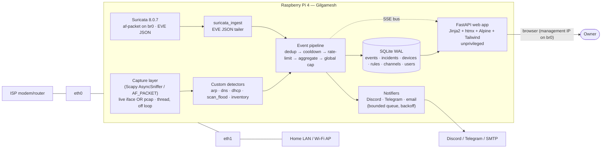

# Gilgamesh — Implementation Plan

**Status:** Phase 1 (research) complete · Phase 2 (clarifications) answered · **this is Phase 3 (the plan)**.
**Scope decision (D-026):** deadline is soon → **MVP only**. Items #7–#11 are documented as future work.
**Product:** a home-network NIDS for a Raspberry Pi 4 (4 GB) that sits **inline**, detects common home-network attacks, and alerts via **Discord / Telegram / email** through a **web-only** UI. **Detect-and-alert only — never blocks or degrades traffic.**

---

## 1. Summary (10 lines)

1. Gilgamesh bridges `eth0`+`eth1` into `br0` between the modem/router and the home LAN (Mode A), so it sees all LAN↔WAN plus broadcast ARP/DHCP/NDP.
2. Two sensors feed one pipeline: **Suricata 8.0.7** (ET Open signatures, EVE JSON) and **custom Scapy/AF_PACKET detectors** (ARP, DNS, DHCP, scans, inventory).
3. Every detection becomes one normalized **Pydantic v2 event** → dedup → cooldown → rate-limit → incident aggregation → global cap → SQLite (WAL) → notifiers + live UI.
4. The user configures everything in a browser: first-run wizard, dashboard (live SSE), alerts, devices, rules, notifications, health, settings.
5. Storage is **SQLite WAL** with retention/pruning tuned for SD-card wear.
6. FastAPI + Jinja2 + **htmx 2.0.11** + **Alpine CSP** + **Tailwind v4** (standalone CLI, built CSS committed). Offline-first: everything vendored.
7. Privilege separation: sensors get `CAP_NET_RAW`; the web app runs unprivileged with no capabilities.
8. Licence **GPL-2.0-or-later** (D-020); Scapy kept in-process; `python-multipart` avoided.
9. Testable without the Pi: all detectors run against synthetic Scapy packets and PCAP files on the dev machine (C10).
10. Built and tested on x86_64 Fedora (dev) but **pinned to Python 3.13** and audited for **aarch64 wheels** to match Raspberry Pi OS trixie.

---

## 2. Final architecture



**Why each component:**

- **Transparent bridge (`br0`)** — the only placement a non-expert can insert without a managed switch, and the only one that sees LAN↔WAN unicast (a passively-plugged Pi sees almost nothing). STP off (NetworkManager defaults it on). Capture happens **once** on `br0`, never on both member ports.
- **Suricata** — signature engine (item #6). Runs as a **separate process** so its GPLv2 does not link into our code. It cannot alert on ARP and gives facts not verdicts, so it is only one of two sensors.
- **Custom detectors** — ARP/DNS/DHCP/scan/inventory need state and baselines Suricata does not keep. Pure functions over parsed packets, so they are unit-testable from synthetic Scapy packets and PCAPs.
- **Event pipeline** — the brief's core requirement: one attack must never send thousands of alerts. Five bounded stages keyed on a `dedup_key`.
- **SQLite WAL** — one config source of truth + event store + IPC between the privileged sensor process and the unprivileged web process. No extra daemon on a 4 GB box.
- **Notifiers** — a bounded async queue so an outage of Discord/Telegram/SMTP can never block detection.
- **FastAPI web app** — the only user interface (C2); runs unprivileged with `DynamicUser`.
- **SSE** — live dashboard via FastAPI's native `fastapi.sse` and a ~10-line `EventSource` glue we own (no `htmx-ext-sse`, licence unverified).

---

## 3. Detection matrix

Full detail and citations: `docs/research/02-detection-catalogue.md`, consolidated in `08-detection-matrix.md`.

| # | Attack | Method | Data source | Default threshold (tunable) | Main false-positive sources | Severity | MVP? | How to test |
|---|---|---|---|---|---|---|---|---|
| 1 | **ARP spoofing/poisoning** | Custom state machine: IP→MAC binding table; gateway-MAC change; two MACs one IP; gARP flood; unsolicited replies; Ethernet-vs-ARP mismatch | Scapy ARP + Ethernet | Gateway MAC change → immediate; non-GW change after 1st outside ±5 s of a DHCP event; gARP flood >20 replies/10 s/MAC; 300 s warm-up | DHCP churn/lease handover, Wi-Fi roaming/mesh/repeaters, VM failover, secondary IPs, gARP at iface-up (RFC 5227) | **high** | ✅ | Synthetic ARP packets: spoofed gateway MAC → alert; legit DHCP renewal → none |
| 2 | **DNS spoofing** | Outstanding-query table keyed on `dns_id`; resolver allowlist from DHCP; conflicting answers; suspicious TTL | Scapy DNS (UDP/53) + DHCP-derived resolver | No matching query → within 2 s window; non-allowlisted responder → after allowlist populated; conflicting answers → ≥3 non-overlapping sets in 30 s; TTL ≤1 = flag only | CDN/anycast/GSLB, round-robin, split-horizon, mDNS/LLMNR, multiple resolvers, DoH/DoT (invisible), CNAME chains | **high** (spoof), **low** (conflict) | ✅ | Spoofed reply with no query → alert; round-robin A-record → none |
| 3 | **Rogue DHCP / starvation** | Trusted-server learning; rogue OFFER/ACK; `routers[]`/`dns_servers[]` drift; DISCOVER rate + distinct `chaddr` | Scapy DHCP (67/68) + `suricata` dhcp | Rogue server → 1st once trust set; else ≥2 distinct servers/60 s; drift → 1st, medium; starvation → >50 DISCOVER/s or >100 distinct `chaddr`/10 s; 5 min learning | Two legit servers (ISP + mesh), failover, relay, travel routers/NAS/`dnsmasq`, reboot storms, MAC-randomising phones | **high** (rogue), **medium** (drift) | ✅ | Rogue OFFER from unknown server → alert; DHCP renew from known server → none |
| 4 | **Port scans + SYN flood** | Per-source dst-port set (vertical), per-source dst-host set (horizontal), per-dst SYN counters + completion ratio | Scapy TCP/IP | Vertical >20 ports/src/10 s (exclude established); horizontal >20 hosts/port/10 s; SYN flood >100 SYN/s to one dst or >1000/s to HOME_NET, or completion ratio <0.2 | Speed tests, P2P/torrents, backups, OS/AV update fan-out, **constant inbound WAN scan noise**, NAT, UDP mDNS/SSDP/NetBIOS | **medium** (scan), **high** (flood) | ✅ | nmap-style vertical scan in a pcap → alert; ongoing TLS session → none |
| 5 | **New/unknown device** | Device inventory; first-sighting event; locally-administered bit → "likely randomised" | Scapy ARP/DHCP + EVE dhcp/arp/flow | Event (not rate); emit info/low after 600 s learning; coalesce per MAC; randomised MAC → low, unknown → medium | MAC randomisation (biggest), guests, mesh bridging, IoT link-local then DHCP, IPv6 privacy addresses (RFC 4941), VMs/containers | **low/medium** | ✅ | New MAC in traffic → info event; known device → none |
| 6 | **ET Open signatures** | Suricata 8 + `suricata-update`; EVE `alert` → event; per-category severity; noisy categories rate-limited | Suricata EVE JSON | Per-category defaults; noisiest categories start at `threshold: type limit, track by_src, seconds 3600, count 1` | Enterprise/perimeter tuning: P2P, games, PUA, IoT protocols, CDN/QUIC/DoH | per signature | ✅ | Test ET signature fires end-to-end into pipeline + UI |
| 7–11 | IPv6 rogue RA/NDP, MAC flooding, ICMP redirect, DNS tunnelling, beaconing | — | — | — | — | — | ❌ **Later (v1.1)** — deferred per D-026 | — |

**Engine baseline facts:** Suricata 8.0.7 has no ARP rule keyword (decoder+logger only); it gives parsed facts, not baselines; its DHCP keyword surface is tiny; its DNS EVE is rich (`id` + `answers[].ttl`); Scapy dissects all required L2–L4 protocols.

---

## 4. Tech stack (exact versions, licences, sources)

| Layer | Component | Version | Licence (SPDX) | Source |
|---|---|---|---|---|
| Runtime | Python | 3.13.x (pinned) | PSF-2.0 | https://docs.python.org/3/license.html |
| Pkg mgr | uv | 0.12+ | MIT OR Apache-2.0 | https://github.com/astral-sh/uv |
| Web | FastAPI | 0.143.0 | MIT | https://github.com/fastapi/fastapi |
| ASGI | Starlette | 1.8.0 | BSD-3-Clause | https://github.com/encode/starlette |
| Server | Uvicorn | 0.54.0 | BSD-3-Clause | https://github.com/encode/uvicorn |
| Validation | Pydantic (+ settings) | 2.14.1 | MIT | https://github.com/pydantic/pydantic |
| Templates | Jinja2 | 3.1.6 | BSD-3-Clause | https://github.com/pallets/jinja |
| Capture/parse | Scapy | 2.8.0 | GPL-2.0-only | https://github.com/secdev/scapy |
| Hashing | argon2-cffi | 25.1.0 | MIT | https://github.com/hynek/argon2-cffi |
| Sessions | itsdangerous | current | BSD-3-Clause | https://github.com/pallets/itsdangerous |
| Rate limit | limits | 5.8.0 | MIT | https://github.com/alisaifee/limits |
| HTTP client | httpx | current | BSD-3-Clause | https://github.com/encode/httpx |
| Email | aiosmtplib | current | MIT | https://github.com/cole/aiosmtplib |
| DB | SQLite (stdlib `sqlite3`) | OS | Public domain | https://sqlite.org/copyright.html |
| Signature IDS | Suricata (separate process) | 8.0.7 | GPL-2.0-only | https://github.com/OISF/suricata |
| Rules | ET Open | feed `suricata-7.0.3` | MIT / BSD-3-style (ambiguous, both permissive) | https://rules.emergingthreats.net/open/ |
| UI | htmx | 2.0.11 (pinned D-009) | 0BSD | https://github.com/bigskysoftware/htmx |
| UI state | Alpine.js (CSP build) | 3.17.4 | MIT | https://github.com/alpinejs/alpine |
| CSS | Tailwind CSS v4 (standalone CLI) | 4.3.3 | MIT | https://github.com/tailwindlabs/tailwindcss |
| Tests | pytest, pytest-asyncio | current | MIT / Apache-2.0 (dev-only) | https://github.com/pytest-dev/pytest |
| Lint | ruff, pyright | current | MIT | https://github.com/astral-sh/ruff |

Project licence: **GPL-2.0-or-later**. Full table + exclusions: `docs/research/12-licenses.md`.

---

## 5. Repository layout

```text
gilgamesh/
├── pyproject.toml            # uv project; ruff/pyright/pytest config; [project.scripts] (infra only)
├── uv.lock                   # committed — reproducible installs
├── .python-version           # 3.13
├── LICENSE                   # GPL-2.0 text (project is GPL-2.0-or-later)
├── README.md
├── install.sh                # idempotent, non-interactive installer (infrastructure, not a UI)
├── AGENTS.md  PROMPT.md
├── deploy/
│   ├── systemd/              # gilgamesh-sensor.service, gilgamesh-web.service, gilgamesh-rules-update.{service,timer}
│   ├── sysusers.d/           # service accounts
│   ├── tmpfiles.d/           # /run/gilgamesh socket/state dir
│   ├── logrotate/            # log rotation (SD wear)
│   └── suricata/             # generated overrides + disable.conf/enable.conf templates
├── src/gilgamesh/
│   ├── __init__.py
│   ├── config.py             # settings + DB-as-source-of-truth config rendering (atomic file writes)
│   ├── models.py             # normalized Event + Device/Rule/Channel/User/Session (Pydantic v2)
│   ├── db.py                 # SQLite WAL, schema, migrations, bounded retention/pruning
│   ├── pipeline.py           # dedup → cooldown → rate-limit → aggregate → global cap
│   ├── i18n.py               # user-facing strings (single table; translation-ready, D-022)
│   ├── sensors/
│   │   ├── base.py           # Detector ABC + ParsedPacket input contract
│   │   ├── capture.py        # live iface (AsyncSniffer) OR pcap replay source (C8)
│   │   ├── runner.py         # sensor process entrypoint; owns capture thread; writes to DB
│   │   ├── arp.py            # #1
│   │   ├── dns.py            # #2
│   │   ├── dhcp.py           # #3
│   │   ├── scan_flood.py     # #4
│   │   ├── inventory.py      # #5
│   │   └── suricata_ingest.py# #6 EVE JSON tailer → Event
│   ├── notifiers/
│   │   ├── base.py           # bounded queue + worker + retry/backoff + severity filter
│   │   ├── discord.py  telegram.py  email.py
│   ├── web/
│   │   ├── app.py            # FastAPI app, lifespan, routers, security headers
│   │   ├── auth.py           # login, sessions, CSRF, lockout, Argon2id
│   │   ├── sse.py            # native SSE event bus
│   │   ├── deps.py           # dependencies (current user, CSRF check, db handle)
│   │   ├── routes/           # dashboard, alerts, devices, rules, notifications, health, settings, wizard
│   │   └── templates/        # Jinja2 pages + htmx partials
│   └── util/                 # redaction, time, mac/ip normalisation, atomic writes, validation
├── static/
│   ├── css/app.css           # built Tailwind output (committed)
│   ├── css/input.css         # Tailwind source (v4 CSS-first)
│   ├── js/vendor/            # htmx.min.js, alpine csp build (+ VENDOR.md with sha256)
│   └── js/app.js             # our EventSource glue + small helpers
├── tests/                    # pytest: unit + integration + pcap fixtures
│   ├── fixtures/             # synthetic pcap files
│   └── ...
└── docs/                     # PROMPT.md, PROGRESS.md, DECISIONS.md, PLAN.md, BLOCKERS.md, DEMO.md, research/
```

Every module under ~300 lines; split when larger.

---

## 6. Data model

**Normalized event (Pydantic v2 `Event`; D-004):** `id (uuid)`, `ts (UTC datetime)`, `type (enum)`, `severity (enum info/low/medium/high/critical)`, `src_mac`, `src_ip`, `dst_mac`, `dst_ip`, `interface`, `summary (str)`, `details (dict)`, `detector (str)`, `dedup_key (str)`, `incident_id (int|null)`.

**SQLite tables** (WAL; `PRAGMA journal_mode=WAL`, `synchronous=NORMAL`, `busy_timeout=5000`, `foreign_keys=ON`):

| Table | Key columns | Indexes |
|---|---|---|
| `schema_version` | version | — |
| `events` | id, ts, type, severity, src_mac, src_ip, dst_mac, dst_ip, interface, summary, details(JSON), detector, dedup_key, incident_id | `(ts)`, `(type,ts)`, `(severity,ts)`, `(dedup_key)` |
| `incidents` | id, dedup_key, first_ts, last_ts, count, max_severity, sample_event_id, acknowledged | `(last_ts)`, `(acknowledged)` |
| `devices` | mac (PK), ips(JSON), hostname, vendor, first_ts, last_ts, trusted, randomised | `(last_ts)`, `(trusted)` |
| `arp_bindings` | ip, mac, first_ts, last_ts, iface | PK `(ip,mac)` |
| `dhcp_state` | key, value(JSON) | PK key |
| `dns_state` | key, value(JSON) | PK key |
| `rule_settings` | rule_id (PK), enabled, params(JSON) | — |
| `suppressions` | id, rule_id, match(JSON), note, created_ts | `(rule_id)` |
| `channels` | id, kind, config(JSON), min_severity, enabled, quiet_start, quiet_end | — |
| `users` | id, username (unique), password_hash, created_ts, totp? (v1.1) | `(username)` |
| `sessions` | sid (PK), user_id, created_ts, last_seen_ts, expires_ts, csrf_token | `(expires_ts)` |
| `login_attempts` | id, key (account or ip), ts, success | `(key,ts)` |
| `audit_log` | id, ts, user_id, action, detail(JSON) | `(ts)` |

**Retention:** age-based (default 30 days) **and** row-cap pruning, in bounded batches (default 5000), triggered on a timer; optional `incremental_vacuum`. Indexes above keep alert filtering fast.

---

## 7. Routes and pages

| Method | Path | Purpose |
|---|---|---|
| GET | `/setup` | First-run wizard (redirects to `/login` once configured) |
| POST | `/setup` | Create admin account + interfaces/mode + optional first alert channel |
| GET | `/login` | Login page |
| POST | `/login` | Authenticate (CSRF + rate limit + lockout) |
| POST | `/logout` | Destroy session |
| GET | `/` | Dashboard (live feed via SSE; health tiles) |
| GET | `/events/stream` | **SSE** stream of new events/incidents |
| GET | `/alerts` | Alerts list (filter: type, severity, device, date; search) |
| GET | `/alerts/{id}` | Alert detail (+ evidence) |
| POST | `/alerts/{id}/ack` | Acknowledge (htmx) |
| POST | `/alerts/{id}/false-positive` | Mark false positive (+ optional suppression) |
| GET | `/devices` | Device inventory |
| POST | `/devices/{mac}/trust` | Trust / untrust |
| POST | `/devices/{mac}/rename` | Rename |
| GET | `/rules` | Detection rules (toggle + typed params) |
| POST | `/rules/{id}` | Update one rule's enabled/params |
| GET | `/suppressions` · POST `/suppressions` · POST `/suppressions/{id}/delete` | Allowlist management |
| GET | `/notifications` | Channel config |
| POST | `/notifications/{kind}` | Save channel (secrets written server-side, never echoed) |
| POST | `/notifications/{id}/test` | Send test message (surfaces real status) |
| GET | `/health` | System health (CPU/temp/RAM/disk/iface/sensors/rule version) |
| POST | `/health/rules/update` | Trigger `suricata-update` |
| GET | `/settings` | Network mode, retention, account, HTTPS |
| POST | `/settings` | Save settings |
| GET | `/api/healthz` | Liveness (unauthenticated, minimal) |

Pages: **wizard · login · dashboard · alerts (+detail) · devices · rules · notifications · health · settings** (9 pages).

---

## 8. Configuration schema (what the user can set in the UI)

- **Account:** username, password (Argon2id), (v1.1: TOTP).
- **Network:** mode (`bridge` default | `span`), LAN interface, WAN interface, management IP/prefix (read-only display; actual changes are documented Pi steps, not executed by the app).
- **Detection rules (per built-in rule id):** `enabled` (bool) + typed params only — ints, floats, enums, IP/CIDR, MAC, durations (D-017; **no user regex, no free-text rules**). Sensitivity presets: `relaxed | balanced | strict`.
- **Allowlists / suppressions:** trusted IP↔MAC bindings, trusted DHCP servers, trusted resolvers, per-rule suppression entries.
- **Devices:** trust/untrust, rename.
- **Notifications:** per channel `enabled`, `min_severity`, backend params (Discord webhook URL; Telegram bot token + chat id; SMTP host/port/TLS/user/password/from/to), quiet hours.
- **Retention:** event age days, max rows, prune batch size.
- **HTTPS:** off (HTTP on LAN, default) | self-signed (generate) | user-provided cert/key.

All values validated with bounded types before storage; rendered into engine config atomically; never passed through a shell.

---

## 9. Security design & threat model (of Gilgamesh itself)

**Controls:** Argon2id password hashing (rehash-on-login); opaque server-side sessions (rotatable, idle + absolute timeout) in a signed cookie; CSRF synchronizer token (htmx `hx-headers` + hidden inputs, `hmac.compare_digest`); login lockout per account + per-IP `limits`; UI bound to the management interface only; optional self-signed HTTPS; secrets stored `0600` and never logged/echoed; parameterized SQL only; Pydantic validation on every input; no shell from user input; path-traversal guards on any file path; security headers (CSP without `unsafe-eval` — Alpine CSP build; HSTS only under HTTPS); input body-size limits.

**Privilege separation:** sensors = `CAP_NET_RAW` only; web app = unprivileged `DynamicUser`, no capabilities. systemd hardening: `ProtectSystem=strict`, `NoNewPrivileges=yes`, `PrivateTmp=`, `ProtectHome=yes`, `SystemCallFilter=@system-service`, `UMask=0077`, `RestrictAddressFamilies`.

**Threat model (abridged):**

| Threat | Mitigation |
|---|---|
| LAN attacker steals/forges session | `HttpOnly`+`SameSite=Lax`+`Secure`(under TLS) cookies; server-side revocable sessions; rotation on login |
| Brute-force / credential stuffing | Argon2id cost; per-account lockout + per-IP rate limit; concurrency cap on hashing |
| CSRF from a malicious page | Synchronizer token + Origin/Fetch-Metadata checks + `SameSite=Lax` |
| Compromised web process | Unprivileged, no capabilities, strict sandbox → cannot capture or touch network config |
| Secret leakage via logs | Redaction layer; secrets never echoed by the UI; `0600` files |
| Alert-weaponisation / DoS of the box | Bounded pipeline + global rate cap; cgroup limits; body-size limits; single worker |
| Rule-injection via config | Typed params only; atomic rendering into fixed paths; no shell, no user regex (D-017) |
| Supply chain | Pin versions; record SPDX + URL (C1); audit dependency licences from `uv.lock` |

---

## 10. Resource budget (Pi 4, 4 GB)

| Component | Target RAM | CPU | Disk writes |
|---|---|---|---|
| Suricata 8 + ET subset | ≤ 900 MiB (measure; trim rules if higher) | ~0.5–1 core at home rates | EVE log (rotated) |
| Sensor process (Scapy/AF_PACKET) | ≤ 350 MiB | ≤ 1 core | DB batches |
| Web app (Uvicorn, 1 worker) | ≤ 250 MiB | bursty | SQLite WAL |
| SQLite / OS / systemd | ≤ 400 MiB | low | bounded |
| **Total target** | **≤ ~2.0 GiB of 4 GB** | headroom for bursts | bounded by retention |

Mitigations: WAL, `noatime`, `tmpfs` for transient files, journald caps, logrotate, bounded batch pruning. The sensor gets `OOMScoreAdjust` protection over the web tier.

---

## 11. Milestones (14) — each ≤ ~300 changed lines, with an acceptance test

> Build order follows PROMPT §4. `Deps` = prior milestones. Every milestone ends with `uv run ruff check . && uv run ruff format --check . && uv run pytest` green for its tests, then a commit.

| M | Goal | Files | Deps | Acceptance test (exact) |
|---|---|---|---|---|
| **M1** | **Walking skeleton:** uv project (Py3.13), FastAPI app, SQLite WAL, normalized `Event`, one **fake** detector, minimal dashboard + SSE | `pyproject.toml`, `.python-version`, `src/gilgamesh/{__init__,config,models,db}.py`, `sensors/base.py`, `sensors/fake.py`, `web/app.py`, `web/sse.py`, `templates/base.html`, `templates/dashboard.html`, `tests/conftest.py`, `tests/test_skeleton.py` | — | `uv run pytest tests/test_skeleton.py -q` → **passes** (fake event stored, appears in dashboard HTML + JSON) |
| **M2** | **Event pipeline:** dedup → cooldown → per-key rate limit → incident aggregation → global cap, bounded LRU | `src/gilgamesh/pipeline.py`, `tests/test_pipeline.py` | M1 | `uv run pytest tests/test_pipeline.py -q` → **passes**, incl. 10 000-event burst producing a bounded alert count |
| **M3** | **ARP spoofing detector (#1)** | `sensors/arp.py`, `tests/test_arp.py` | M2 | `uv run pytest tests/test_arp.py -q` → gateway-MAC-change alerts; benign DHCP renewal does **not** |
| **M4** | **DNS spoofing detector (#2)** | `sensors/dns.py`, `tests/test_dns.py` | M2 | `uv run pytest tests/test_dns.py -q` → no-query reply alerts; round-robin/CDN replies do **not** |
| **M5** | **DHCP detector (#3)** | `sensors/dhcp.py`, `tests/test_dhcp.py` | M2 | `uv run pytest tests/test_dhcp.py -q` → rogue server alerts; known-server renew does **not** |
| **M6** | **Scan + SYN-flood detector (#4)** | `sensors/scan_flood.py`, `tests/test_scan_flood.py` | M2 | `uv run pytest tests/test_scan_flood.py -q` → vertical scan + SYN flood alert; active TLS session does **not** |
| **M7** | **Device inventory (#5)** | `sensors/inventory.py`, `tests/test_inventory.py` | M2 | `uv run pytest tests/test_inventory.py -q` → new MAC event (randomised→low); known device silent |
| **M8** | **Capture abstraction + sensor runner:** live iface **or** pcap source, BPF, `store=False`, capture thread off the asyncio loop; PCAP replay harness | `sensors/capture.py`, `sensors/runner.py`, `tests/fixtures/*.pcap`, `tests/test_pcap_replay.py` | M3–M7 | `uv run pytest tests/test_pcap_replay.py -q` → replaying fixture PCAPs drives real detectors end-to-end |
| **M9** | **Suricata integration (#6):** EVE JSON tailer → `Event`; render `disable.conf`/`enable.conf` from DB; runtime reload | `sensors/suricata_ingest.py`, `config.py` (render), `tests/test_suricata_ingest.py`, `deploy/suricata/` | M8 | `uv run pytest tests/test_suricata_ingest.py -q` → a sample EVE `alert` line becomes a stored event; reload command rendered correctly |
| **M10** | **Notifiers:** Discord + Telegram + email, bounded queue, retries/backoff, per-channel severity, quiet hours, "Send test" | `notifiers/{base,discord,telegram,email}.py`, `tests/test_notifiers.py` | M2 | `uv run pytest tests/test_notifiers.py -q` (mocked transport) → transient failure retries then succeeds; outage does not block |
| **M11** | **Rules & allowlist UI** | `web/routes/rules.py`, `web/routes/alerts.py` (suppress), templates, `tests/test_rules_ui.py` | M9 | `uv run pytest tests/test_rules_ui.py -q` → toggle + typed param save, suppression silences a matching event |
| **M12** | **Auth + first-run wizard** | `web/auth.py`, `web/routes/wizard.py`, `web/deps.py`, templates, `tests/test_auth.py` | M1 | `uv run pytest tests/test_auth.py -q` → wizard creates admin; login works; CSRF-missing POST rejected; lockout after N failures |
| **M13** | **UI completion:** dashboard SSE, alerts (filter/search/detail/ack), devices, notifications, health, settings | `web/routes/{dashboard,devices,notifications,health,settings}.py`, templates, `static/js/app.js`, `tests/test_ui_routes.py` | M11, M12 | `uv run pytest tests/test_ui_routes.py -q` → every page renders 200 when authed; SSE emits an event |
| **M14** | **Hardening + deploy:** install.sh, systemd units, capabilities, vendored assets + VENDOR.md, README, DEMO.md | `install.sh`, `deploy/**`, `static/js/vendor/**`, `static/css/app.css`, `README.md`, `docs/DEMO.md`, `tests/test_deploy_artifacts.py` | all | `uv run pytest tests/test_deploy_artifacts.py -q` → units parse (`systemd-analyze verify` on Linux if available, else file assertions); assets present with recorded sha256 |

**Critical path for the deadline:** M1 → M2 → M3..M7 → M8 → M9 → M10 → M12 → M13 → M14. M11 may follow M13 if time is short.

---

## 12. Test plan & demo script

**Test strategy (C10 — no Pi needed):**
1. **Unit tests** for every detector: synthetic Scapy packets via a `ParsedPacket`/Scapy input contract; each detector gets a **positive** test (attack → alert) and a **negative** test (benign traffic → no alert).
2. **Pipeline tests:** dedup/cooldown/rate-limit/aggregation/global-cap, plus a 10 000-event burst bound.
3. **PCAP replay tests:** checked-in fixture pcaps feed real detectors through the same code path as live capture.
4. **Web tests:** FastAPI `TestClient` for routes, auth, CSRF, SSE; htmx fragment assertions.
5. **Notifier tests:** `httpx`/SMTP mocked; retry/backoff and non-blocking behaviour verified.
6. **Deploy-artifact tests:** units/scripts/assets present and well-formed; asset hashes recorded.

**Demo script (`docs/DEMO.md`, final version in M14):** on a lab setup **the user builds** (network namespaces/veth — never a real network):

| Step | Action (lab only) | Expected Gilgamesh result |
|---|---|---|
| 1 | Complete the wizard, add a Discord/Telegram/email channel, click **Send test** | Test message arrives; health shows channel OK |
| 2 | ARP-spoof the gateway (Scapy/`arpspoof` in the lab) | **high** "Gateway MAC changed" alert in the live feed + notification |
| 3 | Spoof a DNS reply with no matching query | **high** "DNS response without matching query" alert |
| 4 | Start a rogue DHCP server (`dnsmasq`) | **high** "Rogue DHCP server" alert |
| 5 | `nmap` vertical scan of one host | **medium** "Port scan" alert |
| 6 | `hping3 --flood -S` at one host | **high** "SYN flood" alert |
| 7 | Plug in a new device (or spoof a new MAC) | **info/low** "New device" event; mark it trusted in the UI |
| 8 | Trigger an ET Open test signature | Suricata signature alert shown with category + severity |

**FP-tolerance check (fast, no 7-day soak given the deadline):** replay a captured benign home-traffic pcap through every detector and assert **zero** high-severity alerts.

---

## 13. Risks, honest limitations, future work

| Risk | Impact | Mitigation |
|---|---|---|
| Scapy too slow on Pi 4 (A4 unverified) | Missed packets under load | BPF filters, `store=False`, off-loop thread, raw `AF_PACKET` fast path; measure in Phase 2 lab |
| Suricata 8 + ET Open rule-format mismatch (A2) | No signature coverage | Verify with `suricata-update`; fallback = curate a rules subset; custom detectors are unaffected |
| FP flood makes the tool useless | Owner stops trusting alerts | Conservative defaults, dedup/cooldown/aggregation, allowlists, FP replay test |
| 4 GB exhaustion | Crashes / packet loss | Component budgets, cgroup caps, `OOMScoreAdjust` favouring the sensor |
| Power loss while inline cuts the link | Home loses internet | Documented honestly; recommend a UPS; fail-to-wire module likely unavailable (D13) |
| SD-card wear | Device dies in months | WAL + bounded writes, tmpfs for transient files, `noatime`, optional USB SSD |
| Self-signed HTTPS warnings scare users | Adoption | Default HTTP-on-LAN with a clear warning; HTTPS opt-in |
| Deadline is soon (D-026) | Later detectors not built | Strict MVP scope; items #7–#11 documented as future work |

**Honest limitations (what each mode cannot see):**
- **Mode A (bridge):** cannot see **LAN↔LAN** traffic that stays inside another switch/AP; cannot see traffic that never crosses `br0`; **DoH/DoT** hides DNS from the DNS detector; traffic during the boot window is missed.
- **Mode B (SPAN):** only whatever the switch mirrors; no ARP from ports not mirrored.
- **Both:** encrypted payloads are opaque (signature coverage degrades on TLS 1.3); IPv6 features beyond basic NDP are not covered in v1.

**Future work:** IPv6 rogue-RA/NDP spoofing; MAC-flood/CAM-overflow; ICMP-redirect abuse; DNS-tunnelling heuristics; beaconing detection; router mode (NAT/DHCP) — explicitly out of scope; TrueNAS/HA options.

---

### Appendix — Phase mapping

This plan's milestones supersede the earlier phase sketch. Milestone ↔ original phase:
M1 = Phase 2/3 foundation · M2 = Phase 3 pipeline · M3–M7 = Phase 4 sensors · M8 = Phase 4 capture · M9 = Phase 5 · M10 = Phase 6 · M11 = Phase 7 (rules) · M12/M13 = Phase 7 (auth/UI) · M14 = Phase 8/9/11 · FP/attack validation = Phase 10 (reduced for the deadline).
