# Using Gilgamesh

Everything you do with Gilgamesh happens in the browser, and every page is
designed to be understood at a glance. This guide walks through each page in the
order you'll meet them, tells you what to do about an alert when one arrives,
and finishes with the small print: what Gilgamesh can't see.

No terminal is needed after the install — this whole guide is browser and
common sense. If you haven't installed yet, the
[install guide](INSTALL.md) comes first.

---

## The first evening checklist

Ten relaxed minutes, in this order:

1. **Sign in** at `http://<the-pi's-IP>:8080` with the account you made during
   setup.
2. **Open Devices** and press **Trust** on the gadgets you recognise — your
   laptops, phones, TV, printer. Trusting doesn't hide anything from the
   detectors; it only calibrates their baseline. Anything you renamed (press
   the ✏️ button) reads like a house, not like a list of MAC addresses.
3. **Open Alerts out** and set up one notification channel — this is how
   Gilgamesh reaches you when you're not staring at the dashboard.
4. Press **Send test** on that channel and watch the message land on your
   phone. If it lands, you're done.
5. Leave the Pi alone for a few days. It spends its first days in *learning
   periods* (see Rules below) and says less than it will say later, on purpose.

---

## The dashboard — what's happening right now

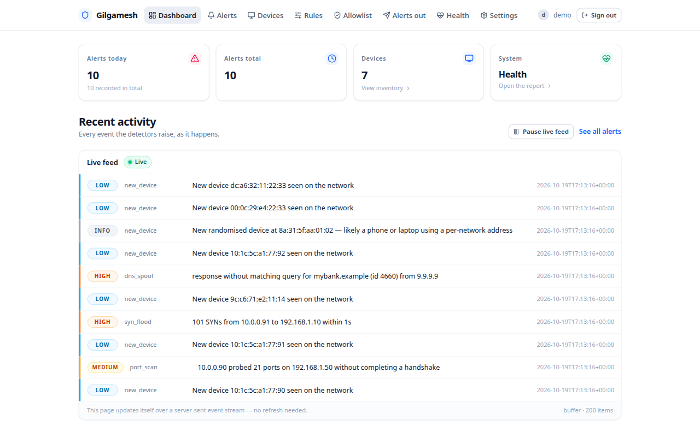

The dashboard is one screen: four tiles on the way in, and **Recent activity**
below them.

- **Alerts today / Alerts total** — how busy the network has been.
- **Devices** — how many devices the sensors have met; the tile itself is a
  link to the inventory.
- **System → Health** — a red flag appears here when the box itself needs you;
  the tile is a link to the full report.
- **Live feed** — every event as it happens, newest first, with a coloured
  severity pill on the left edge. Reloads by itself; the page says so at the
  bottom.

### The pause button (and why it's not decoration)

Press **Pause live feed** during a storm and the feed freezes — new alerts are
counted, not lost. The button reads **Resume live feed** when frozen, and a
little **+N while paused** note appears near it:

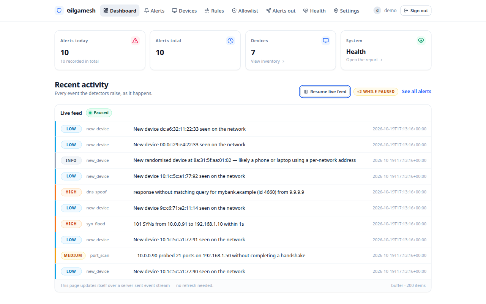

Resume and everything buffered pours in at once. Nothing is thrown away while
paused, and the count in *Alerts today* never stops being truthful just because
you were reading something else.

On a phone, the same dashboard reflows to one column with an icon-only nav bar
(the icons carry accessible names for screen readers) — this is
Gilgamesh at 390 px:

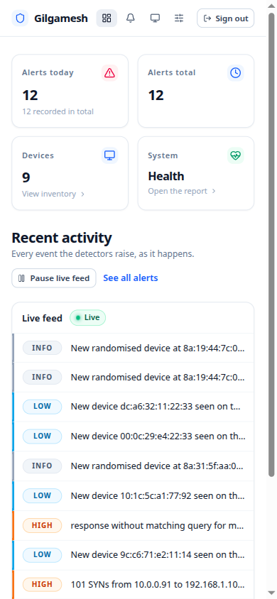

---

## Alerts — the record of everything the sensors have said

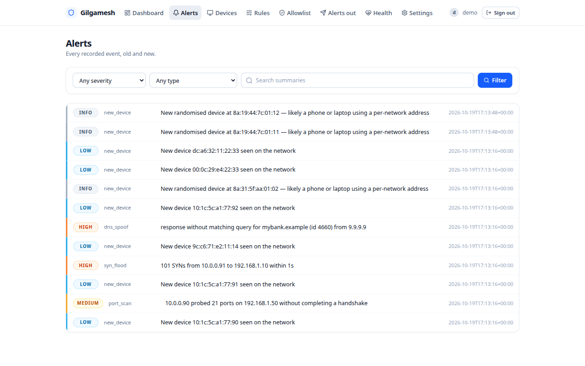

The list shows **every** event from day one, newest first. Filters sit above:

- **Severity** — "show me only the scary ones".
- **Type** — only `dns_spoof`, only `new_device`, and so on.
- **Search** — free-text over the alert summaries ("mybank", "10.0.0.90").

Every row is a link to the full detail page.

### The detail page — the evidence, not just the headline

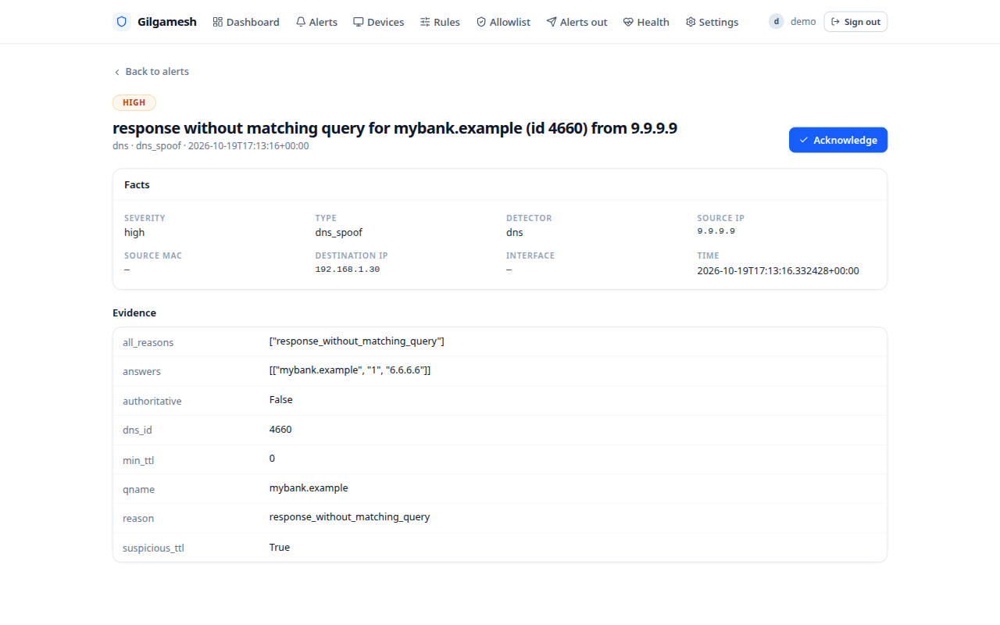

Two sections:

- **Facts** — the summary in fixed fields: severity, type, which detector
  spoke, source MAC/IP, destination, interface, exact time.
- **Evidence** — the raw numbers the detector saw (for a DNS alert: the query
  name, the answer, the DNS transaction id, whether anything looked
  TTL-manipulated). This is what makes Gilgamesh rule out vandalism: when a
  detector says "this smells wrong", the smell is materialised here, and the
  **Acknowledge** button records that you've seen it.

---

## "I got an alert — what now?"

First, the severity bar, and what usually earns each level in a home:

| Level | What it means | Typical peace-of-mind response |
|---|---|---|
| **info** | something worth a shrug, e.g. a device using a *randomised* MAC (privacy addresses on modern phones) | read it now and then; no action |
| **low** | new device you haven't met, or a DNS answer set that conflicts with your resolver's habits | usually your own gadget; Trust it on the **Devices** page |
| **medium** | behaviour models an attack but can also be a busy tool, e.g. a port scan | read the Facts grid; if you recognise the source, continue; if not, see below |
| **high** | a real attack pattern, e.g. the router's MAC suddenly changing, 100+ SYNs in a second, forged DNS answers | don't ignore — this is the "check today, not at the weekend" level |
| **critical** | an incident escalated by *repeating* — the same attack kept happening through the cooldown | treat as high, and confirm it stopped |

Then, the practical move, which is the same whatever the alert is:

1. **Open the detail page and read the Facts.** The source MAC/IP is either a
   device you know or a device you don't.
2. **A device you know?** Devices page → **Trust** it (if it's yours) or pull
   its power (if it shouldn't be there). The alert was your network telling you
   something; the response is on your network, not in Gilgamesh.
3. **A device you don't know?** Find what it is: the Facts grid has its IP and
   MAC. If it turns out to be routine (a network scanner you ran, a corporate
   laptop running its own agent), put it on the **Allowlist** so its named rule
   goes quiet — for *that one device*, not for everyone.
4. **The Pi itself acting up?** The Health page's system tiles catch that
   before it becomes an alert about the network.

A worked example: the **Gateway MAC changed** alert fires when the router's IP
suddenly starts being advertised by a different MAC address. On a quiet evening
that's usually a mesh/repeater or a reboot of the router; at 3 a.m. when nobody
at home was touching anything, it's worth standing up. The **Evidence** table
shows the previously known MAC (`known_mac`) and whatever claimed it
(`claimed_mac`) — your own hardware's MACs are printed on their boxes, so this
page alone usually ends the conversation.

---

## Devices — the invitations list

Every gadget the sensors have met lives here, with the tabs **All / Untrusted /
Trusted**.

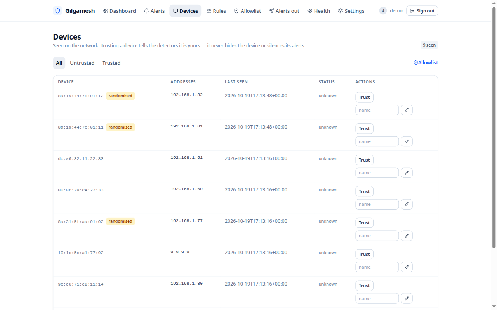

- **Trust** — "this is mine, baselines: learn, don't shout". Un-trusting a
  trusted device (same button flips) puts it back into ordinary scrutiny; it
  never deletes history.
- **Rename** — `living-room-tv` at a glance instead of `3c:5a:b4:...`. The
  renamed name appears everywhere devices are shown.
- The **randomised** badge marks addresses modern phones and laptops generate
  per-network for privacy. Their alerts are downgraded to `info` for being
  unremarkable; trust those after you've seen them for a week or so.
- **9 seen** top-right is the count; the tab you're on names what you're
  looking at.

---

## Rules — how loud the alarm is, rule by rule

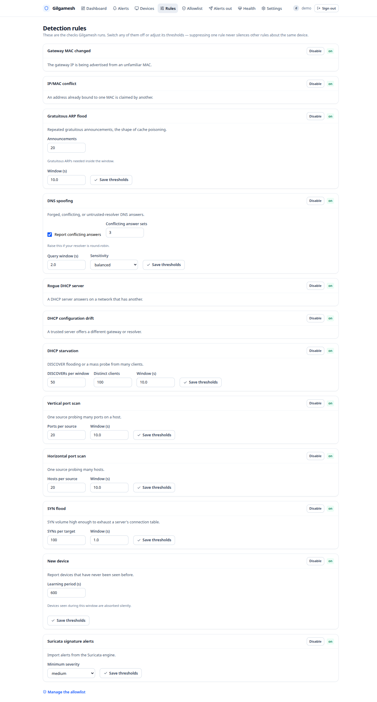

Twelve built-in rules, one card each. Every card has:

- a **Disable / Enable** switch that updates in place (no page reload), with
  the current `on` / `off` state shown next to it, and
- where a rule takes thresholds (a count, a time window, a sensitivity), typed
  and bounded **parameters** with a **Save thresholds** button. Values are
  validated before being stored — a mis-typed field never half-saves.

All twelve in one line each:

| Rule | Watches for | Your knobs |
|---|---|---|
| Gateway MAC changed | your router's IP advertised by an unfamiliar MAC | — |
| IP/MAC conflict | two different MACs claiming one address | — |
| Gratuitous ARP flood | cache-poisoning-shaped bursts of "I'm here!" announcements | burst size, window |
| DNS spoofing | forged/unmatched/untrusted-resolver answers | conflicting-answers toggle, threshold, query window, sensitivity |
| Rogue DHCP server | a second "office manager" handing out addresses | — |
| DHCP configuration drift | your trusted server starts offering different gateways/resolvers | — |
| DHCP starvation | DISCOVER floods or a mass of clients wearing out the address pool | flood count, distinct clients, window |
| Vertical port scan | one source knocking on many **ports** of one host | ports threshold, window |
| Horizontal port scan | one source knocking on many **hosts** | hosts threshold, window |
| SYN flood | SYNs arriving fast enough to exhaust a target's connection table | SYN count, window |
| New device | a never-seen-before device joins | **learning period** |
| Suricata signature alerts | the signature engine's matches | minimum severity to import |

Two knobs are worth naming for new households:

- **New device → Learning period.** For the first N seconds after the sensors
  start, newly seen devices are quietly absorbed instead of alerted (default:
  600 s = 10 minutes). Set it to 0 for instant alerts, longer while you're
  still filling the inventory.
- **DNS spoofing → Sensitivity.** `relaxed`/`balanced`/`strict` shifts how
  much ambiguity is tolerated before the rule fires. If your home uses a
  round-robin resolver that the threshold labels "conflicting answers", raise
  **Conflicting answer sets** instead of disabling the rule.

Disabling one rule has a precise meaning: *that* rule stops reporting. Other
rules about the same device keep working, and the detections the disabled rule
would have seen are not counted anywhere else.

---

## Allowlist — "stop telling me about this exact thing"

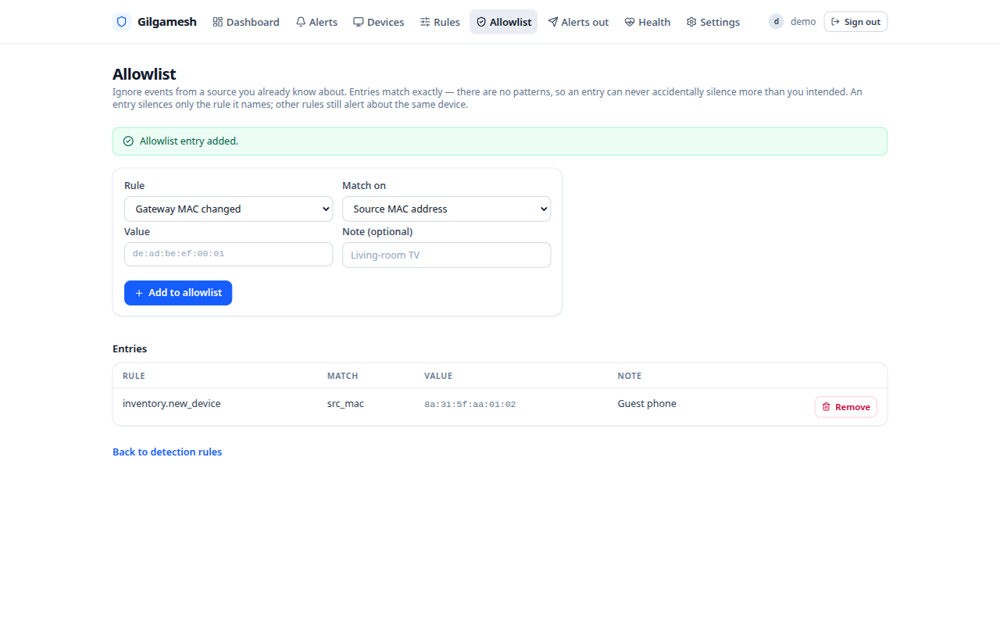

An entry says: **rule X, for value Y, keep quiet — I know about this.**

- Matching is **exact**, on normalised values (a MAC, an IP, a detector name).
  There are no wildcards and no patterns — an entry can never accidentally
  silence more than you intended.
- An entry only silences *its own rule*. Allowing one scanner's IP under
  "Vertical port scan" says nothing about the SYN flood rule; other rules about
  the same device still alert.
- **Note** is a free-text reminder ("living-room TV", "work laptop's security
  agent") stored next to the entry.
- Entries are removed just as exactly: one **Remove** button each.

---

## Alerts out (notifications) — how Gilgamesh reaches you

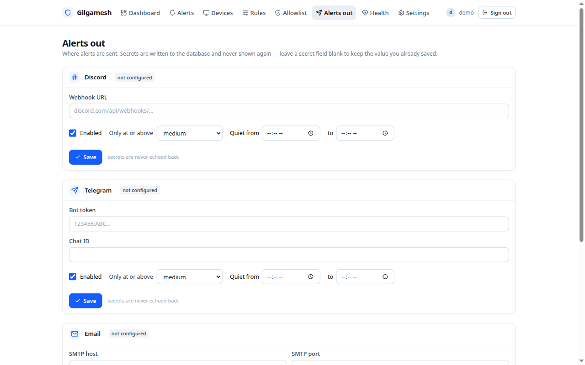

One card per channel, nothing configured until you type it in:

- **Discord** — a *webhook URL*. In your server: Edit channel → Integrations →
  Webhooks → New webhook → Copy URL. Paste, Save, **Send test**.
- **Telegram** — a *bot token* (from [@BotFather][botfather], which also shows
  the exact steps) and a **chat id** (from [@userinfobot][userinfo] for your
  own chat; both plain controls, no groups needed).
- **Email** — SMTP host/port/username/password, sender, recipients, and the
  two TLS checkboxes (they start checked, which suits nearly every provider).

Every card carries:

- **Enabled** — the channel's master switch.
- **Minimum severity** — "info" sends everything (noisy); the useful default is
  `medium` or `high` so the phone only vibrates for real things.
- **Quiet hours** — a window during which this channel stays silent in your
  feed but still records: `22:00` to `07:00` works, including across midnight.
- **Send test** — a real message to the real channel; if the channel is
  misconfigured, the page tells you what the provider actually said, not a
  fake "looks fine".

Saved secrets are never printed back — the fields read
`•••• saved — leave blank to keep`, so a shoulder-surfer (or a screenshot)
learns nothing, and a blank field keeps the stored value instead of wiping it.

---

## Health — the machine report

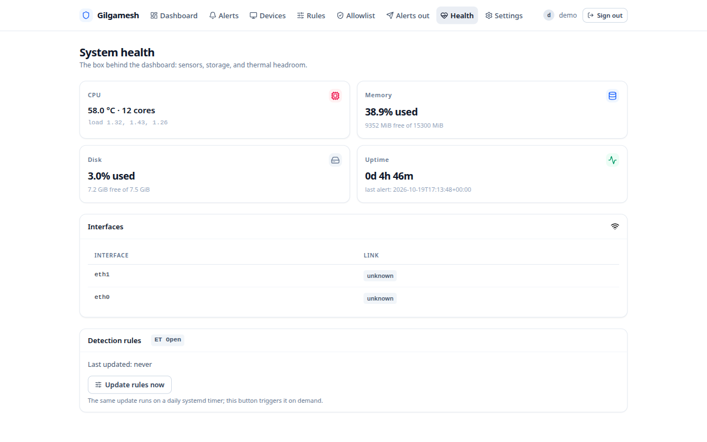

Four tiles (**CPU / Memory / Disk / Uptime**), an **Interfaces** card, and a
**Detection rules** card summarising every rule's state. The **Update rules
now** button runs `suricata-update` for you there and then. What makes this page trustworthy when
it matters is the inverse: when a box dies or senses nothing, it says so here
instead of silently refusing to complain.

---

## Settings — the durable knobs

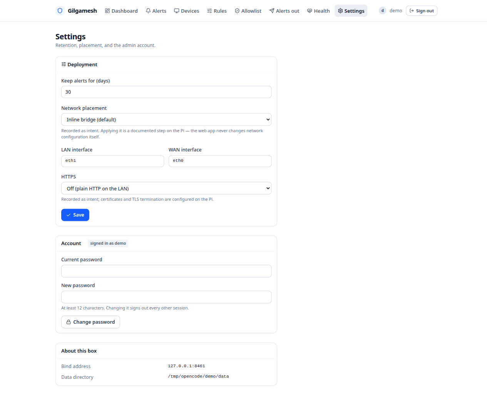

- **Keep alerts for (days)** — alert history retention; 30 by default, as the
  SD card inside the Pi 4 is written less and it burns in fewer cycles.
- **Network placement** — store your topology so pages can say "Bridge" or
  "SPAN" and bind the LAN/WAN interface names in the deploy config template;
  actual interface *changes* remain the installer's / Mode B command's job,
  never the web app's — Gilgamesh never touches the host's networking.
- **HTTPS** — `off` (plain HTTP on your LAN — the default, and fine inside a
  home), a `self-signed` generated key, or a `provided-by-you` key pair.
- **Account** — change the admin password (asks for the current one; the
  policy is the same as at setup).
- **About this box** — what the service actually named itself and which rules
  update schedule it last completed.

---

## A quiet word about noise

The calibration point for everything above: **a home network is noisy, and
Gilgamesh knows it**. Its whole pipeline is built so normal life (backups,
speed tests, browsing storms, phone MAC randomisation, your ISP's CDN changing
answers mid-page) produces silence or an `info`/`low` instead of an alert, and
every detector documents its own false-positive guards — that design content
lives in `docs/research/08-detection-matrix.md` if you ever want the full map.

If a rule cries wolf more than you'd like, the order of operations is:
**thresholds first** (the rule's own knobs), **allowlist** for a known-good
device, **minimum severity** for the channel, then — only ever last — a
**Disable** of the rule. A home NIDS that someone has silenced entirely is just
a small box that runs warm; the goal is to hear the one alert that matters.

---

## What Gilgamesh deliberately can't see

So you're never surprised:

- **Encrypted traffic content.** Everything is TLS today; nothing can read the
  inside of those packets — Gilgamesh watches *behaviour*: who talks to whom,
  how hard, how often, in what patterns, and what kind of connection a
  handshake tried to open. Signature rules see through TLS 1.3 only when
  metadata leaks something worth a rule.
- **LAN↔LAN traffic that doesn't cross the bridge** (rooms on the same
  switch/AP talking to each other in Mode A; or in Mode B, traffic between two
  devices behind the same downstream switch).
- **DNS over HTTPS / TLS** (DoH/DoT) — the resolver channel is encrypted, so
  forged answers on that channel are invisible; the DNS spoofing rule watches
  the classic port-53 path, which is what the majority of everyday devices use.
- **IPv6 tricks** beyond basic neighbour discovery are on the project's
  roadmap, not in this version (see `docs/PLAN.md` §13).

And one boundary worth repeating: Gilgamesh sees and says; it never blocks.
The response to "this looks like an attack" is yours to choose — turn a device
off, change a Wi-Fi password, unplug a camera — while the box keeps watching,
quietly, the whole time.

---

[botfather]: https://t.me/BotFather "BotFather on Telegram — creates bots"
[userinfo]: https://t.me/userinfobot "Shows your Telegram user and chat id"
